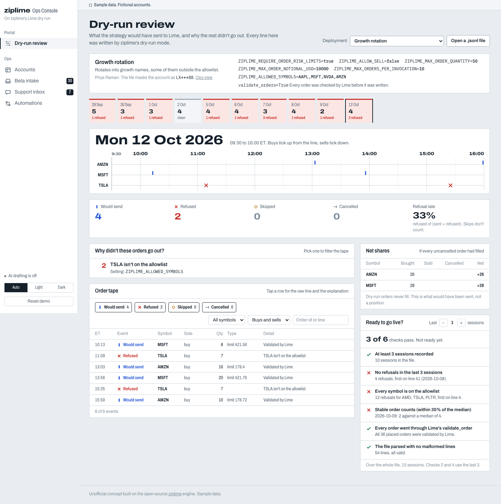
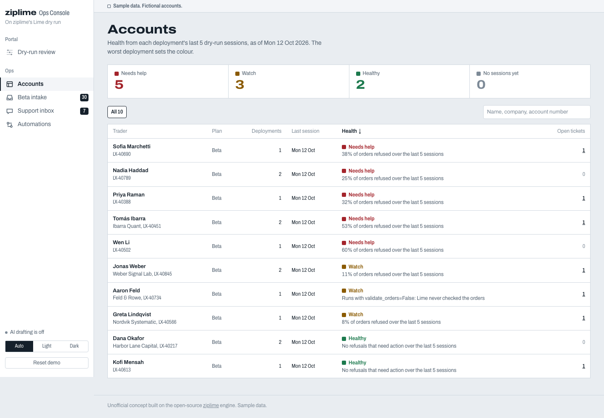
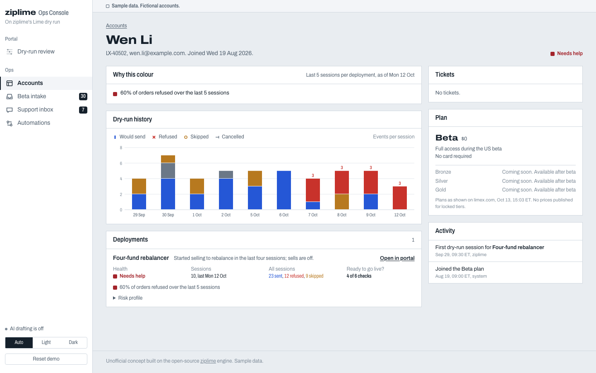
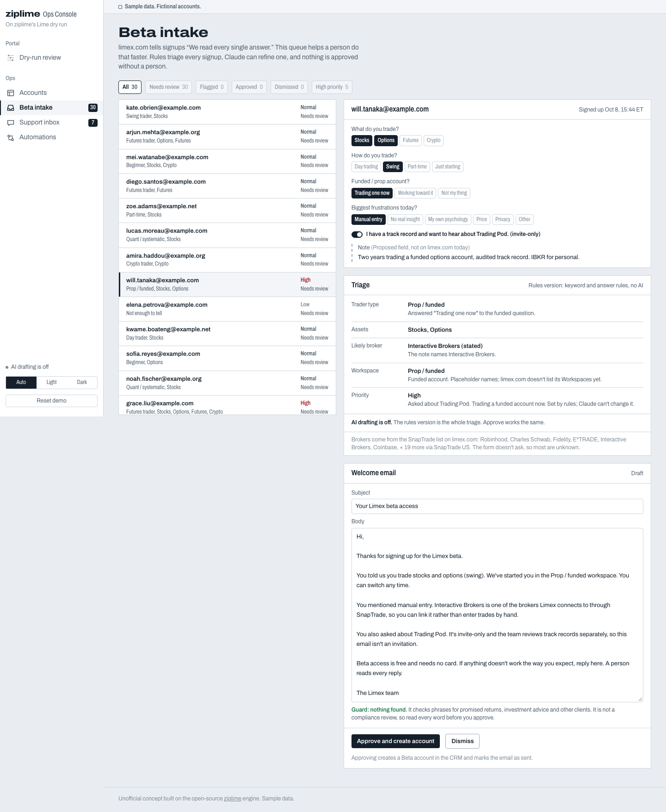
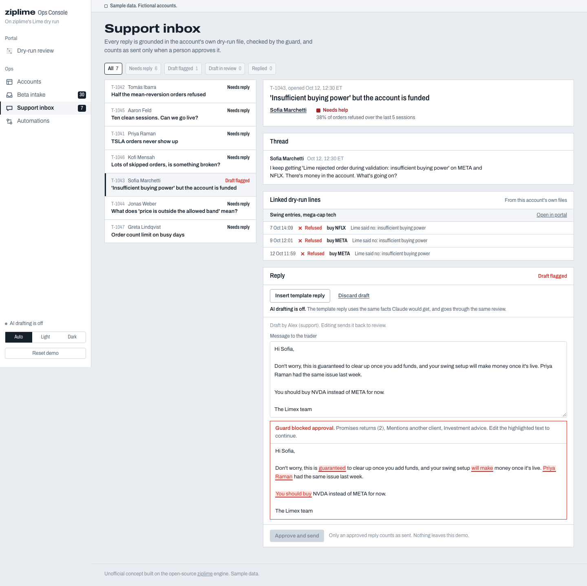
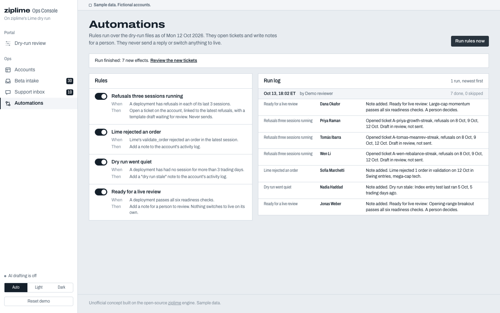

# ziplime Ops Console

An unofficial concept: what Limex could run on top of ziplime's Lime dry-run mode (issue #5, branch `feat/dry-run-orders`). All data is sample data. Accounts, names, emails and tickets are fictional.

- **Client portal**: a trader opens a dry-run file and sees which orders would have gone out, which were refused or skipped, and why, on the 09:30 to 16:00 ET clock.
- **Ops CRM**: the Limex team sees account health, triages Beta signups, answers support tickets with drafts grounded in the account's own file, and runs automation rules.
- **People decide**: nothing counts as sent and no account is created until a person clicks Approve, and a guard blocks approval while the text promises returns, gives investment advice or mentions another client.



## How it connects to the dry-run feature

With `LimeTraderSdkExchange(dry_run_file=...)`, every order still goes through lot rounding, the fail-closed `ZIPLIME_*` risk limits, the order deadline and Lime's `validate_order`, and is then appended to a JSON Lines file instead of reaching `place_order`. The file has four events: `place`, `refuse`, `skip` and `cancel`.

This console only reads that file:

- `src/lib/dryrun/parse.ts` parses it defensively. A malformed line is reported with its line number and the rest still loads. Unknown fields are kept, so a newer engine version doesn't break it.
- `src/lib/dryrun/explain.ts` maps every refusal string the engine can write (copied from `lime_trader_sdk_exchange.py`) to a plain explanation: what happened, which setting fired, what to change. It's deterministic. Claude is asked only about a reason that matches no rule, such as an unfamiliar message from Lime's `validate_order`.
- `src/lib/dryrun/metrics.ts` computes net shares and the six "Ready to go live?" checks. `src/lib/health.ts` computes account health.

Nothing here imports, edits or installs into `../ziplime`.

### Where the seed files come from

`scripts/generate_seed.py` runs the real engine. It imports `LimeTraderSdkExchange` from `../ziplime` and the test suite's fake Lime client (`FakeAsyncLimeClient`), builds one exchange per session with each deployment's risk profile, and submits orders. Every line in `data/seed/dryruns/*.jsonl` was written by the engine itself. No real credentials are used, and nothing runs live.

**One thing in the seed run is not real: the clock.** The script replaces the exchange module's `datetime` with a shim whose `now()` returns the simulated bar time plus a few milliseconds. Without it, every `recorded_at` would be the time the script ran, cancels couldn't sit on the session clock, and the order-deadline scenario couldn't happen. Everything else is the engine's own code path.

The commit the seed ran against is recorded in `data/seed/manifest.json` (`f67e372`, branch `feat/dry-run-orders`). Reruns produce byte-identical files.

```
npm run seed    # PYTHONDONTWRITEBYTECODE=1 ../ziplime/.venv/bin/python scripts/generate_seed.py
```

## Run it

```
npm install
npm run dev          # http://localhost:3000
```

Claude is optional. Without `ANTHROPIC_API_KEY` the app works fully: the UI says "AI drafting is off", support replies use a template built from the same facts, and intake uses the rules triage. To turn it on:

```
ANTHROPIC_API_KEY=... npm run dev
ANTHROPIC_MODEL=claude-sonnet-5-5   # optional; this is the default
```

The key stays on the server. Three routes use it: `/api/explain`, `/api/draft` and `/api/triage`. `/api/ai-status` reports only whether a key is set. Each prompt carries one account's or one signup's data. `/api/draft` looks up the linked dry-run lines server side, in that account's own files.

State lives in `localStorage` (`ziplime-ops-console:v1`). **Reset demo** in the rail clears it. Opened `.jsonl` files stay in memory for the tab and are never uploaded.

## Tests

```
npm test             # vitest: 215 tests
npm run test:e2e     # Playwright smoke test over the production build, desktop and 390 px
npm run lint
npm run build
```

The vitest suite covers:

- **Parser**: malformed lines, wrong types, CRLF, BOM, DST, cancels across sessions.
- **Seed files**: every one parses cleanly and matches the manifest.
- **Explanations**: every engine message is mapped, and the regexes are anchored.
- **Readiness and health**: each threshold at its boundary, plus the expected colour for every seeded account.
- **Guard**: each category, word boundaries, other-client identifiers, and the intake-only checks.
- **Intake triage**: per persona, broker tags and priority.
- **Approve flows**: exactly one account per signup; nothing sent while the guard flags the text.
- **Automations**: the second run only skips.

The Playwright test runs without an API key. It walks through:

1. Portal, plus an upload with a malformed line.
2. CRM.
3. Approving a signup into an account.
4. A flagged draft that can't be approved, then a template reply that can.
5. Running the rules twice.
6. Reload and reset.
7. A check that no page scrolls sideways.

## Pages

| Route | Who | What |
|---|---|---|
| `/` | anyone | What this is, and the path an order takes in dry run |
| `/portal` | trader | Session strip, session clock, counts, why orders didn't go out, order tape, net shares, readiness checklist, open a `.jsonl` file |
| `/ops` | Limex team | Accounts with health in words, sortable and filterable |
| `/ops/accounts/[id]` | Limex team | Health reasons, history chart, deployments and risk profiles, tickets, plan, activity |
| `/ops/intake` | Limex team | Beta intake queue: rules triage, optional Claude triage, guarded welcome email, approve into the CRM |
| `/ops/inbox` | Limex team | Tickets linked to real orders, template or Claude drafts, guard, approve |
| `/ops/automations` | Limex team | Four rules with on/off, Run rules now, run log |

| | |
|---|---|
|  |  |
|  |  |
|  |  |

Phone, 390 px: 

## Sources and decisions

- **Plans**: `src/lib/plans.ts` is the one place plan names live. It matches what limex.com's pricing section showed on 2026-10-13 at 15:03 ET: Beta at $0 ("Full access during the US beta", "No card required"), and Bronze, Silver and Gold locked, "Coming soon. Available after beta", with no prices. Every seeded account is on Beta, and no prices are invented.
- **Beta intake form**: the signups mirror the row limex.com's early-access form posts (checked 2026-10-13, 15:30 ET):
  - an email;
  - four optional multi-select questions;
  - the Trading Pod toggle.

  The free-text `note` is a proposed field that limex.com doesn't have, and the UI labels it so.
- **Brokers**: the six that limex.com lists as connected via SnapTrade. A broker is tagged `stated`, `inferred` or `unknown`; the form never asks.
- **Workspace names**: placeholders, because limex.com doesn't list its Workspaces yet. The UI says so.
- **Health**: computed over each deployment's last 5 sessions, as of the manifest's `asOf` (2026-10-12), so the colours don't drift.
  - **Needs help**: 20% or more of orders refused, or 2 or more Lime rejections.
  - **Watch**: 5% or more refused, 1 Lime rejection, a stale run, `validate_orders=False`, or a reason with no built-in explanation.
- **The guard is a phrase check, not a compliance system.** The UI says that wherever it runs.

## Demo script (3 minutes)

1. **`/` (15 s).** "ziplime's dry run runs every order through the live checks and writes it to a file. This console reads that file." Point at the six-step path.
2. **Portal (60 s).** The default is Priya Raman's growth rotation.
   - Point at the clock: two red crosses on TSLA.
   - In "Why didn't these orders go out?", click "TSLA isn't on the allowlist". The tape filters to those two lines.
   - Open a row: the explanation names `ZIPLIME_ALLOWED_SYMBOLS` and lists what it allows. Show the raw line.
   - Point at "Ready to go live?": 3 of 6 checks pass, with the evidence.
   - Switch to Wen Li's four-fund rebalancer. The sell refusals explain why `ZIPLIME_ALLOW_SELL` can't just be turned on under the fail-closed profile.
   - Optional: drop a `.jsonl` file with one broken line. It shows "Line N: ..." and the rest loads.
3. **Accounts (20 s).** Five accounts need help, three are on watch, two are healthy, and each badge says why in words. Open Wen Li: the history chart shows refusals on the last four sessions.
4. **Automations (25 s).** Click Run rules now.
   - The run opens tickets for three refusal streaks, notes Sofia's Lime rejection and Nadia's stale test run, and flags Harbor Lane momentum for a live review that a person decides.
   - Run it again: everything is skipped.
5. **Inbox (40 s).** Open T-1043, Sofia's ticket.
   - The seeded draft says "guaranteed", "you should buy" and names another client. The guard highlights all three and Approve is disabled.
   - Click Insert template reply. It is built from Sofia's own refusals, the guard passes, and Approve and send adds it to the thread as approved by a person.
   - With a key, Draft with Claude does the same from the same facts.
6. **Beta intake (20 s).** Open will.tanaka: a funded trader who asked about Trading Pod, so priority is high by rule. The broker is "Interactive Brokers (stated)" from the note. The welcome email says the email isn't a Pod invitation. Approve, then open the new account.

## Not verified

- **The Claude paths have not been run against the live API.** No key was available while building, so the three routes are exercised only in their "AI drafting is off" state. The request shapes follow `@anthropic-ai/sdk` 0.133 (`output_config.format` with a JSON schema for triage). Run each once with a key before relying on them.
- **No deployment.** Nothing has been pushed or deployed.
